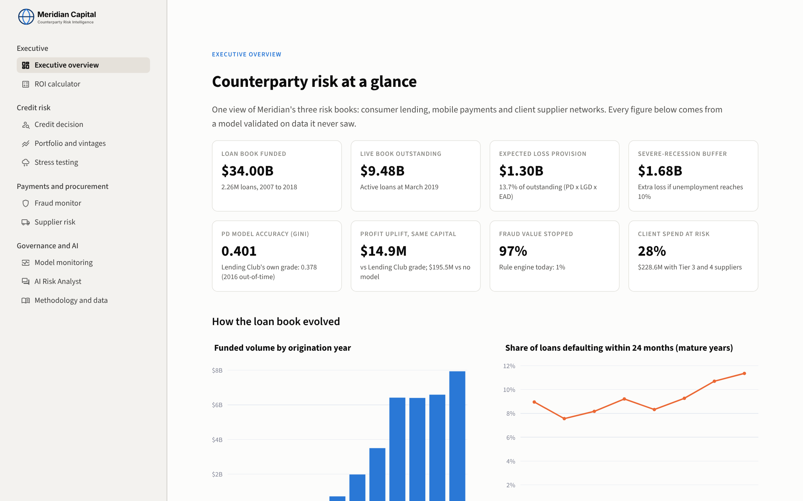
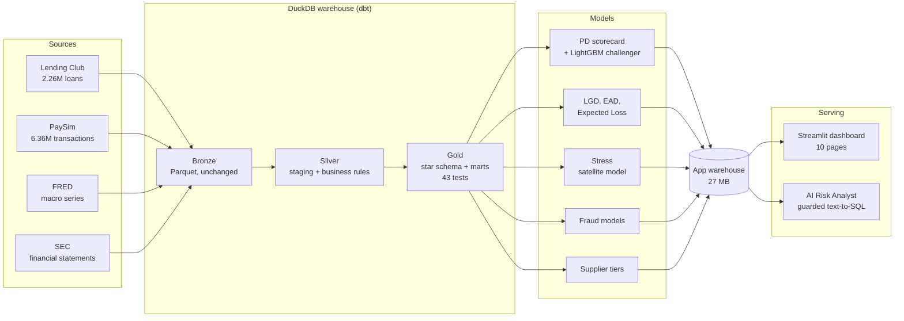
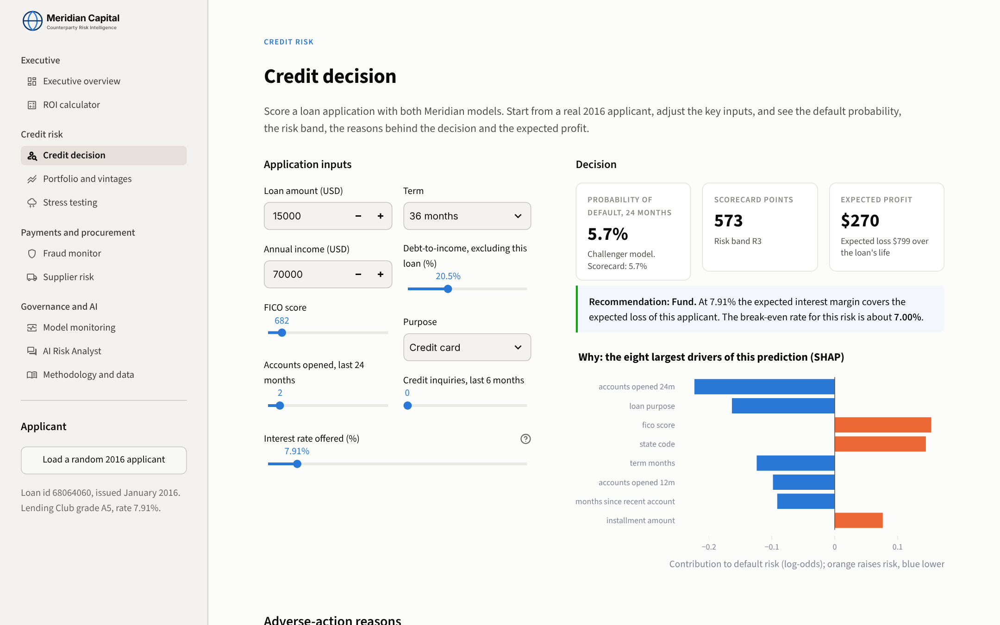
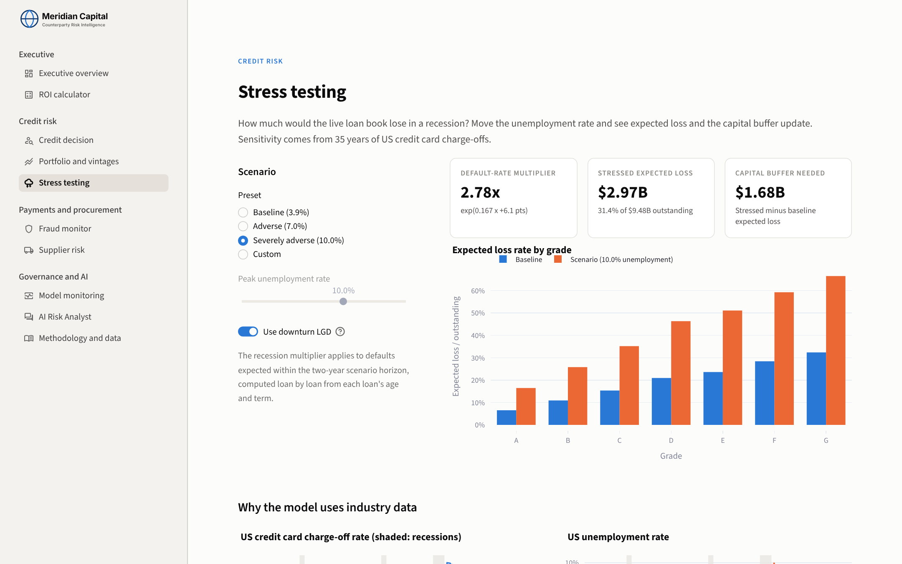
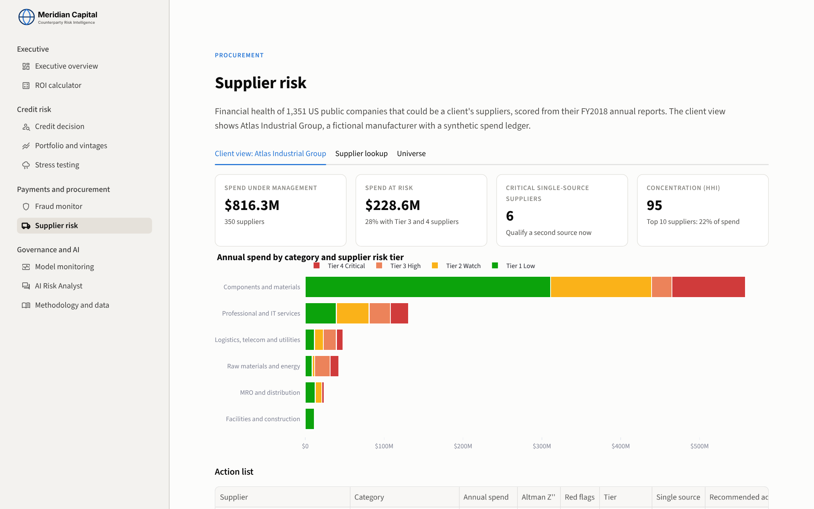
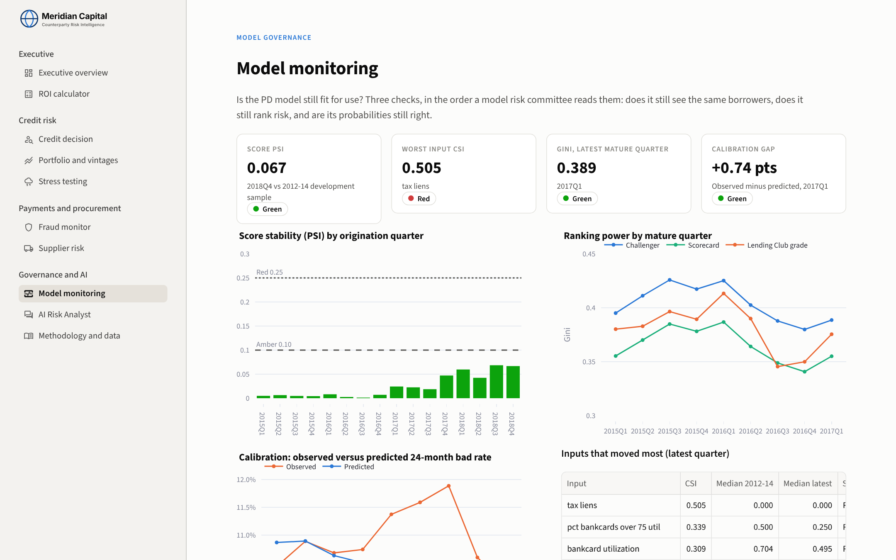

# Meridian Capital · Counterparty Risk Intelligence Platform

**End-to-end credit, fraud and supplier risk analytics on 2.26 million real loans: from raw public data to a SQL warehouse, bank-standard models, a stress test, an interactive dashboard and a guarded AI analyst.**

[](https://github.com/marianunez-data/meridian-risk-intelligence/actions/workflows/ci.yml)


<p align="left">
  <a href="https://meridian-risk-intelligence.streamlit.app"></a>
</p>

**[Try the live dashboard](https://meridian-risk-intelligence.streamlit.app)**: score a loan applicant, run a recession stress test, tune the fraud alert threshold, check a supplier's financial health or ask the AI Risk Analyst a question. No installation needed.

**[Notebooks](notebooks/)** · **[Methodology](docs/methodology.md)** · **[Model card](docs/model_card_pd.md)** · **[Data](data/README.md)**

[](https://meridian-risk-intelligence.streamlit.app)

---

## The business problem

**Meridian Capital** is a fictional mid-size lender built on real public data. It runs three businesses, and each has a risk question the board wants answered:

| Business line | Data used as its book | The question |
|---|---|---|
| Consumer and small-business loans | Lending Club, 2.26M loans, 2007 to 2018 | Who will default, how much will we lose, what would a recession cost, and which loans should our capital fund? |
| Mobile-money payments | PaySim, 6.36M transactions (converted to USD) | How much fraud can we stop, net of the cost of reviewing alerts? |
| Supplier finance and procurement advisory | SEC filings, 1,351 US companies | Which of a client's suppliers could fail, and how much spend is exposed? |

## Results

All credit results are **out of time**: models trained on loans issued 2012 to 2014 and judged once on 2016 loans they never saw.

| Area | Result |
|---|---|
| **PD model** | LightGBM challenger reaches a **Gini of 0.401**, beating Lending Club's own grade (0.378) and a 16-variable WoE scorecard (0.363) |
| **Capital allocation ROI** | With capital for half of the 2016 loan flow, funding by the challenger's expected profit earns **USD 475.0M**: USD 14.9M more than Lending Club's grade and USD 195.5M more than no model, with a **16.8% default rate instead of 20.9%** |
| **Expected Loss** | Live book provision of **USD 1.30B** (13.7% of USD 9.48B outstanding) from PD x LGD x EAD; backtest finds and flags under-reserving in grades D to G |
| **Stress test** | A 2008-style recession (10% unemployment) raises expected loss to **USD 2.97B**: a **USD 1.68B stress capital buffer** |
| **Fraud** | Today's rule engine stops **1%** of fraud value; a model with no balance data stops **97%**, saving **USD 50.6M** in 14 days net of review cost |
| **Procurement** | **28% of a client's spend** (USD 229M) sits with suppliers in the two highest risk tiers; 10 single-source suppliers in those tiers prioritised for action |
| **Monitoring** | Caught a real data-supply change: US credit bureaus removing tax liens from credit reports in 2017 to 2018 |
| **AI analyst** | Text-to-SQL agent over a governed warehouse; **10 of 10 injection-style attacks blocked**; 16-question execution-accuracy evaluation |

## Skills demonstrated

| Data Scientist | Analytics Engineer | AI Engineer |
|---|---|---|
| WoE / IV scorecard with points scaling | Medallion warehouse: raw, bronze, silver, gold | Tool-using LLM agent (text-to-SQL plus RAG) |
| LightGBM with Optuna, monotonic constraints | dbt models, macros, seeds, 43 data tests | Parser-based SQL guardrails, red-team tests |
| SHAP global, dependence and local explanations | Star schema, reconciliation, leakage test | Provider-agnostic: Gemini or Groq free tiers |
| Calibration, PSI / CSI, backtesting by quarter | Window functions, `QUALIFY`, `FILTER`, CTEs | Evaluation harness (execution accuracy) |
| LGD fractional logit, EAD, Expected Loss | SQL data audit at 2.26M rows | Governed catalog with business semantics |
| Macro satellite model, scenario stress test | Hazard rates and velocity features in SQL | Test double to verify the loop in CI |
| Fraud: Isolation Forest, cost-based thresholds | Compact serving warehouse for the app | |
| Profit-based model selection (ROI) | CI: lint, tests, dbt parse, app smoke test | |

## Architecture



## Notebooks

Every notebook tells one part of the story: the question, the method, the result, and what it means for the business, with honest limitations.

| # | Notebook | What it answers |
|---|---|---|
| 00 | [Business context](notebooks/00_business_context.ipynb) | The problem, the decisions, the KPI tree and the ROI framework |
| 01 | [Data ingestion and SQL](notebooks/01_data_ingestion_and_sql.ipynb) | Reconciled warehouse; 8 SQL analyses (growth, risk vs price, maturity bias, vintages, concentration, macro, fraud, suppliers) |
| 02 | [Data audit](notebooks/02_data_audit.ipynb) | Quality scorecard; joint-application anomaly; structural vs informative missingness; leakage audit |
| 03 | [Data cleaning](notebooks/03_data_cleaning.ipynb) | Train-fitted cleaning pipeline; population shift preview |
| 04 | [Exploratory analysis](notebooks/04_exploratory_analysis.ipynb) | Risk drivers, interactions, redundancy, stability, the benchmark to beat |
| 05 | [Feature engineering and WoE](notebooks/05_feature_engineering_woe.ipynb) | Monotonic binning, Information Value, correlation and stability screening |
| 06 | [PD scorecard](notebooks/06_pd_scorecard.ipynb) | Logistic scorecard, points, calibration, risk bands, capital-budget ROI, reason codes |
| 07 | [Challenger and SHAP](notebooks/07_challenger_model_shap.ipynb) | LightGBM, Optuna, monotonic constraints, SHAP, champion decision |
| 08 | [LGD, EAD and Expected Loss](notebooks/08_lgd_ead_expected_loss.ipynb) | Fractional logit, downturn LGD, EAD vs amortisation, EL backtest, live-book provision |
| 09 | [Stress testing and ROI](notebooks/09_stress_testing_and_roi.ipynb) | Why own data fails, satellite model, scenarios, capital buffer, business case |
| 10 | [Fraud detection](notebooks/10_fraud_detection.ipynb) | Velocity features in SQL, simulator artefacts, Isolation Forest, LightGBM, cost-based threshold |
| 11 | [Supplier risk](notebooks/11_supplier_risk_procurement.ipynb) | Altman Z'', validation without labels, risk tiers, spend at risk, supplier finance |
| 12 | [Validation and monitoring](notebooks/12_validation_and_monitoring.ipynb) | PSI, CSI, Gini and calibration over time, segment check, model card |
| 13 | [AI Risk Analyst](notebooks/13_ai_risk_analyst.ipynb) | Agent design, guardrails red-team, retrieval, evaluation |

## Dashboard

**[Open the live dashboard](https://meridian-risk-intelligence.streamlit.app)** (hosted free on Streamlit Community Cloud; if it has been idle it wakes up in about 30 seconds).

| What you can do | Page |
|---|---|
| See the headline KPIs of all three risk books | Executive overview |
| Change funding cost, LGD or capital budget and watch the ROI of each model update | ROI calculator |
| Score an applicant, see the SHAP reasons and the break-even interest rate | Credit decision |
| Filter the book and compare vintage curves | Portfolio and vintages |
| Move unemployment and see expected loss and the capital buffer | Stress testing |
| Compare fraud models hour by hour | Fraud monitor |
| Look up any supplier's Altman Z'' and see a client's action list | Supplier risk |
| Check drift, ranking power and calibration | Model monitoring |
| Ask questions in plain English, or run guarded SQL | AI Risk Analyst |

| Credit decision | Stress testing |
|---|---|
|  |  |
| **Supplier risk** | **Model monitoring** |
|  |  |

Pages: Executive overview · ROI calculator (credit and fraud) · Credit decision (score any applicant, SHAP reasons, break-even rate) · Portfolio and vintages · Stress testing · Fraud monitor · Supplier risk · Model monitoring · AI Risk Analyst · Methodology and data.

## Key design decisions

1. **Out-of-time evaluation, not random splits.** Loans are split by issue year, and only loans observed for a full 24 months carry a label. A random split would let the model see the future it is judged on.
2. **Leakage excluded by construction.** Twenty post-origination fields (one alone scores an AUC of 0.994) never reach the modelling table, and a dbt test fails the build if one does.
3. **Business rules in SQL, learned rules in Python.** Deterministic fixes (household income for joint applications) live in the warehouse; anything fitted on data (caps, medians) is fitted on train only.
4. **Models judged in dollars.** The challenger is selected on profit at a fixed capital budget, not only on AUC.
5. **Honesty over flattering numbers.** PaySim artefacts, the EL under-reserving in risky grades and the confounded macro history are stated and handled, not hidden.

## Run it yourself

```bash
git clone https://github.com/marianunez-data/meridian-risk-intelligence.git
cd meridian-risk-intelligence
python -m venv .venv && source .venv/bin/activate
make setup        # dependencies + package
make data         # download raw data (about 3 GB)
make bronze       # raw -> Parquet
make warehouse    # dbt build: silver, gold, 43 tests
make notebooks    # execute all notebooks (about 1 hour)
make app-data     # export the 27 MB app warehouse
make app          # open the dashboard at http://localhost:8501
```

The dashboard alone needs no data download: `pip install -r requirements.txt && streamlit run app/streamlit_app.py` uses the committed app warehouse.

## Repository structure

```
meridian-risk-intelligence/
├── app/                    Streamlit dashboard (entry: streamlit_app.py), views/, lib/, committed app warehouse
├── data/                   README with sources, sample/ with small CSVs; raw and warehouse files rebuilt by make
├── docs/                   Methodology, model card, deployment guide, screenshots
├── models/                 Trained artefacts: cleaner, WoE bins, scorecard, challenger, fraud, stress
├── notebooks/              00 to 13, executed, with storytelling
├── reports/                CSV outputs written by notebooks (metrics, simulations, audits)
├── scripts/                download, bronze build, app export, agent evaluation
├── sql/                    analysis/ (business questions) and audit/ (data quality) queries
├── src/meridian/           Python package: config, data, features, models, economics, stress, agent
├── tests/                  44 unit tests + dashboard smoke test
├── warehouse/              dbt project: staging, intermediate, marts, seeds, macros, tests
└── Makefile                One command per pipeline step
```

## Data and limitations

- Meridian Capital and Atlas Industrial Group are fictional; the procurement spend ledger is synthetic. Figures illustrate the methods and are not statements about any real company.
- Lending Club publishes accepted loans only, so the PD models do not learn from declined applicants (no reject inference).
- PaySim is simulated and contains artefacts that make fraud easier to detect than in reality; results are reported with an upper bound and a conservative case.
- Small samples of every dataset are in [`data/sample/`](data/sample/); see [`data/README.md`](data/README.md) for sources and a column dictionary.
- Data sources: [Lending Club accepted loans](https://huggingface.co/datasets/codesignal/lending-club-loan-accepted), [FRED](https://fred.stlouisfed.org/), [SEC Financial Statement Data Sets](https://www.sec.gov/dera/data/financial-statement-data-sets), [PaySim](https://huggingface.co/datasets/theman10/paysim).

## Author

**Maria Camila Gonzalez Nuñez** · [GitHub](https://github.com/marianunez-data) · [LinkedIn](https://www.linkedin.com/in/marianunez-data) · [Portfolio](https://marianunez-data.github.io)
